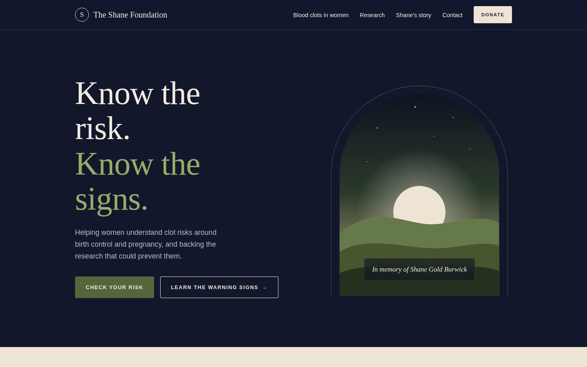
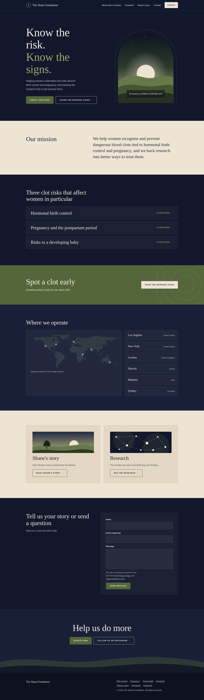

<div align="center">



# The Shane Foundation Homepage Redesign

**Know the risk. Know the signs.**

A dark, editorial homepage concept for a nonprofit raising awareness of blood clot risks linked to birth control and pregnancy.

[About](#about) · [Features](#features) · [Live demo](https://jfuix.github.io/NGO-TSF/) · [Screenshots](#screenshots) · [Run locally](#run-locally) · [Customize](#customize) · [Credits](#credits)

</div>

---

## About

This project is an independent homepage redesign concept for **The Shane Foundation**, focused on making information about blood clot risks related to hormonal birth control, pregnancy, and postpartum health easier to explore.

The design uses an editorial visual direction, combining deep navy backgrounds, warm cream sections, olive accents, expressive serif typography, and clear calls to action. The page brings key information, warning signs, research, Shane's story, the foundation's reach, contact, and donation pathways into one responsive experience.

**Project type:** Nonprofit website redesign concept  
**Role:** Design and front-end development  
**Built with:** HTML, CSS, JavaScript, inline SVG, Google Fonts  
**Status:** Concept / portfolio project

> This is an unofficial portfolio concept, not the foundation's live website. Some content is reworded, map locations are illustrative placeholders, and the contact form is a front-end demonstration only.

## Features

- [x] Deep navy theme with cream sections and an olive green accent
- [x] Elegant serif headlines (Newsreader) with clean sans body text (DM Sans)
- [x] Frosted-glass header, topic rows, contact form and dropdown menu
- [x] Illustrated hero, story and research cards built with inline SVG
- [x] Three clot-risk topics: hormonal birth control, pregnancy and postpartum, and risks to a developing baby
- [x] Warning-signs call-to-action section
- [x] Dotted world map with highlighted sample locations and a matching list
- [x] Story, research, contact and donation sections
- [x] Dropdown navigation and mobile menu
- [x] Visible keyboard focus and reduced-motion support
- [x] Responsive layouts for desktop and mobile
- [x] Single HTML file with no build step
- [ ] Real photography (illustrations are used in this concept)
- [ ] Verified operating locations (map locations are placeholders)
- [ ] Contact form connected to a form handler

## Screenshots



<p align="center">
  
</p>

## Run locally

```bash
git clone https://github.com/JFUIX/NGO---TSF.git
cd NGO---TSF
```

Open `index.html` in your browser. The fonts load from Google Fonts, so an internet connection gives the intended look.

## Customize

- **Colors:** edit the variables at the top of the `<style>` block (`--navy`, `--cream`, `--olive`, and `--sage`).
- **Map locations:** edit the `.places` list and matching `.pin` markers in the “Where we operate” section. The six locations shown are samples.
- **Illustrations and photos:** replace the inline SVG artwork or the `.pic` illustrations with image elements.
- **Contact form:** connect the form to a service such as Formspree or Netlify Forms. It currently displays a demo confirmation only.

## Credits

Designed and developed by [Jaffery / JFUIX](https://github.com/JFUIX). The page copy is reworded for this concept, and the map and illustrations are original. Fonts: Newsreader and DM Sans via Google Fonts.
